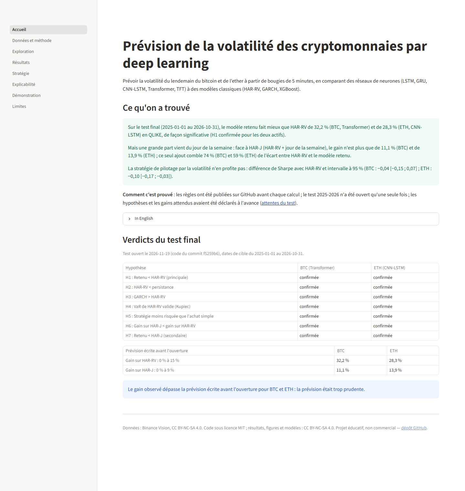
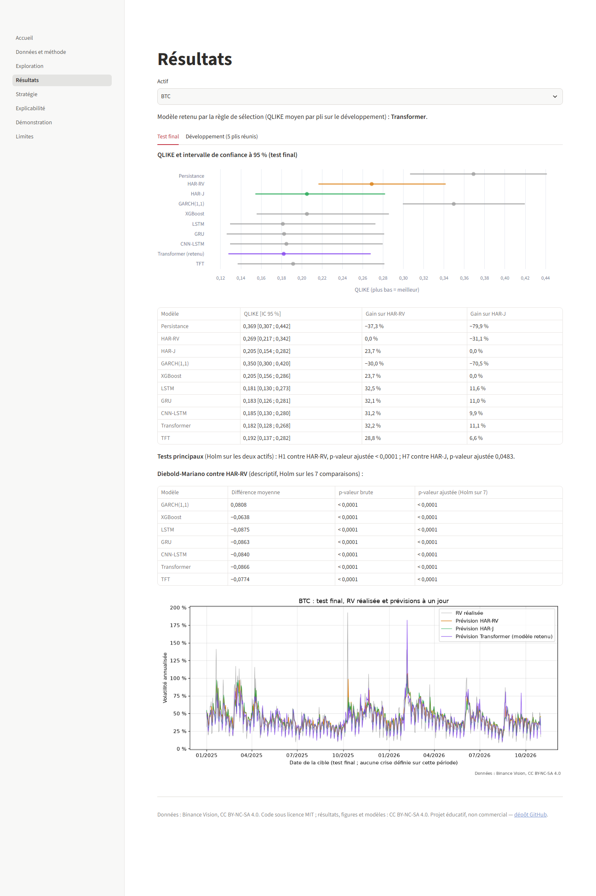
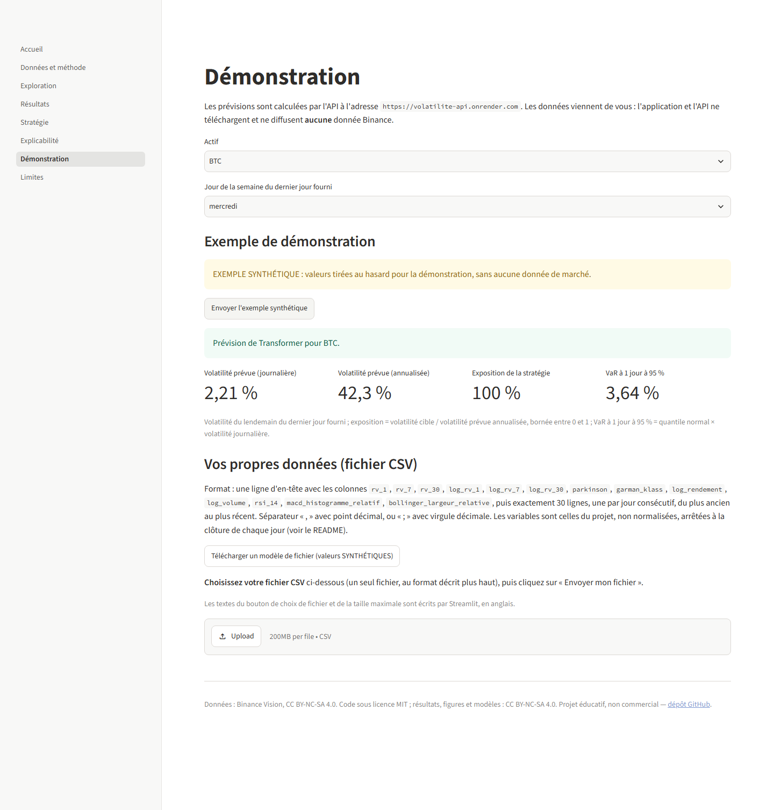

# Prévoir la volatilité de BTC et d'ETH par deep learning

Ce projet éducatif prévoit, chaque soir, la volatilité réalisée du lendemain du bitcoin et de l'ether, à partir de bougies de 5 minutes de Binance. Il compare des réseaux de neurones (LSTM, GRU, CNN-LSTM, Transformer, TFT) à des modèles classiques (HAR-RV, HAR-J, GARCH) et à XGBoost, avec un découpage chronologique strict et des règles publiées avant chaque calcul. Ce qu'on a trouvé, en trois phrases générées depuis les résultats :

<!-- début du bloc généré par src/readme.py : résumé -->
Sur le test final (2025-01-01 au 2026-10-31), le modèle retenu fait mieux que HAR-RV de 32,2 % (BTC, Transformer) et de 28,3 % (ETH, CNN-LSTM) en QLIKE, de façon significative (H1 confirmée pour les deux actifs). Mais une grande part vient du jour de la semaine : face à HAR-J (HAR-RV + jour de la semaine), le gain n'est plus que de 11,1 % (BTC) et de 13,9 % (ETH) ; ce seul ajout comble 74 % (BTC) et 59 % (ETH) de l'écart entre HAR-RV et le modèle retenu. La stratégie de pilotage par la volatilité n'en profite pas : différence de Sharpe avec HAR-RV et intervalle à 95 % (BTC : −0,04 [−0,15 ; 0,07] ; ETH : −0,10 [−0,17 ; −0,03]).
<!-- fin du bloc généré par src/readme.py : résumé -->

<!-- début du bloc généré par src/readme.py : In English -->
### In English

On the final test (2025-01-01 to 2026-10-31), the selected model beats HAR-RV by 32.2% (BTC, Transformer) and 28.3% (ETH, CNN-LSTM) in QLIKE, significantly (H1 confirmed for both assets). But a large part comes from the day of the week: against HAR-J (HAR-RV + day of the week), the gain shrinks to 11.1% (BTC) and 13.9% (ETH); this single addition closes 74% (BTC) and 59% (ETH) of the gap between HAR-RV and the selected model. The volatility-targeting strategy does not benefit: Sharpe ratio difference with HAR-RV and 95% interval (BTC: -0.04 [-0.15, 0.07]; ETH: -0.10 [-0.17, -0.03]). Educational, non-commercial project; data: Binance Vision, CC BY-NC-SA 4.0.
<!-- fin du bloc généré par src/readme.py : In English -->

**En ligne**

- API de prévision : https://volatilite-api.onrender.com (documentation interactive : https://volatilite-api.onrender.com/docs). Service gratuit : il s'endort sans requête, la première réponse peut donc prendre du temps.
- Application : *adresse ajoutée après son déploiement.*
- Synthèse en PDF : [docs/synthese.pdf](docs/synthese.pdf).

## Données et licence

- Source : bougies mensuelles de 5 minutes de Binance spot ([data.binance.vision](https://data.binance.vision)), pour BTCUSDT et ETHUSDT ; période fixée dans [`config/regles.toml`](config/regles.toml).
- Les données sont fournies par Binance sous licence CC BY-NC-SA 4.0 et selon les conditions « Vision Dataset Terms » ; elles sont utilisées ici dans un cadre éducatif et non commercial. Détails et liens : [LICENSE-DONNEES.md](LICENSE-DONNEES.md).
- **Aucune donnée brute ni aucune série journalière dérivée n'est dans ce dépôt.** Seuls sont commités les manifestes (noms, tailles et empreintes SHA-256 des fichiers) et des résultats agrégés. Chacun télécharge les données lui-même (voir « Reproduction complète ») et peut vérifier qu'il a exactement les mêmes fichiers.
- L'API ne télécharge et ne diffuse aucune donnée Binance : l'utilisateur fournit ses données, et l'exemple de démonstration est synthétique (valeurs tirées au hasard).

## Résultats clés

<!-- début du bloc généré par src/resultats_test.py : test final -->
## Résultats du test final

Test ouvert une seule fois le 2026-11-19 (code du commit `f5259b6`), sur les dates de cible du 2025-01-01 au 2026-10-31, avec des [attentes écrites avant l'ouverture](docs/ATTENTES_TEST.md). Détails : [résultats du test final](docs/RESULTATS_TEST.md). Tableau généré depuis `rapports/test_final.json`.

| Hypothèse | BTC (Transformer) | ETH (CNN-LSTM) |
|---|---|---|
| H1 : QLIKE(modèle retenu) < QLIKE(HAR-RV) (principale) | confirmée | confirmée |
| H2 : QLIKE(HAR-RV) < QLIKE(persistance) | confirmée | confirmée |
| H3 : QLIKE(GARCH(1,1)) > QLIKE(HAR-RV) | confirmée | confirmée |
| H4 : VaR de HAR-RV non rejetée par Kupiec | confirmée | confirmée |
| H5 : stratégie du modèle retenu : volatilité et drawdown plus faibles que l'achat simple | confirmée | confirmée |
| H6 : gain du modèle retenu sur HAR-J < gain sur HAR-RV (descriptive) | confirmée | confirmée |
| H7 : QLIKE(modèle retenu) < QLIKE(HAR-J) (secondaire, ajoutée le 2026-11-19) | confirmée | confirmée |
| Gain du modèle retenu sur HAR-RV (prévu : 0 % à 15 %) | 32,2 % | 28,3 % |
| Gain du modèle retenu sur HAR-J (prévu : 0 % à 9 %) | 11,1 % | 13,9 % |
<!-- fin du bloc généré par src/resultats_test.py : test final -->

Le rôle du jour de la semaine sur le développement (HAR-J = HAR-RV + jour de la semaine de la cible) :

<!-- début du bloc généré par src/comparer.py : HAR-J -->
  Conclusion descriptive sur HAR-J (développement, QLIKE moyen par pli ; chiffres lus dans `rapports/comparaison_modeles.json`) :
  - BTC : HAR-J fait 9,9 % de mieux que HAR-RV ; le modèle retenu (Transformer) fait 13,6 % de mieux que HAR-RV, mais seulement 4,2 % de mieux que HAR-J. Le jour de la semaine de la cible, ajouté seul à HAR-RV, comble 72 % de l'écart entre HAR-RV et le modèle retenu.
  - ETH : HAR-J fait 7,5 % de mieux que HAR-RV ; le modèle retenu (CNN-LSTM) fait 15,4 % de mieux que HAR-RV, mais seulement 8,6 % de mieux que HAR-J. Le jour de la semaine de la cible, ajouté seul à HAR-RV, comble 49 % de l'écart entre HAR-RV et le modèle retenu.
<!-- fin du bloc généré par src/comparer.py : HAR-J -->

Autres résultats : [baselines](docs/RESULTATS_BASELINES.md), [deep learning](docs/RESULTATS_DL.md), [stratégie](docs/STRATEGIE.md), [explicabilité](docs/EXPLICABILITE.md), [analyse exploratoire](docs/EXPLORATION.md), [qualité des données](docs/QUALITE_DONNEES.md), [contrôles de fuite](rapports/controles_fuite.json).

### L'application

| Accueil | Résultats (BTC) | Démonstration (après envoi à l'API) |
|---|---|---|
|  |  |  |

Toutes les captures : dossier [docs/captures](docs/captures/01_accueil.png) (toutes les pages, dont une vue sur téléphone).

## Limites

Chaque limite est générée depuis les fichiers de résultats (les mêmes phrases que la page « Limites » de l'application) :

<!-- début du bloc généré par src/readme.py : limites -->
- **Une seule période de test** (du 2025-01-01 au 2026-10-31), sans aucune crise définie : le test ne dit rien d'une nouvelle crise.
- **Covid** : pendant cette crise, 3 réseaux sur 5 (BTC) ; 4 réseaux sur 5 (ETH) ont un QLIKE plus élevé que HAR-RV (descriptif) : les réseaux ne sont pas toujours meilleurs quand le marché change brutalement.
- **H7 de justesse (BTC)** : le modèle retenu bat HAR-J avec une p-valeur ajustée de 0,0483, pour un seuil de 0,05.
- **Prévisions chiffrées trop prudentes** (BTC et ETH) : les gains observés sur le test dépassent les intervalles écrits avant l'ouverture ; notre jugement a priori était mal calibré.
- **Stratégie peu améliorée** : sur le test, la différence de Sharpe entre le modèle retenu et HAR-RV vaut −0,04 [−0,15 ; 0,07] (BTC) ; −0,10 [−0,17 ; −0,03] (ETH) : une meilleure prévision ne donne pas une meilleure stratégie.
- **Une seule graine par combinaison au réglage** : le choix est en partie dû au hasard ; plus petit écart entre la 1re et la 2e combinaison : Transformer sur ETH, 0,1050 contre 0,1051 en MSE de validation.
- **Combinaisons au bord des espaces de recherche** : 10 combinaisons retenues sur 10 ont au moins un réglage à la plus grande valeur permise (le plus fréquent : dropout = 0,3, 7 fois). Des espaces plus larges auraient pu aider ; ils n'ont pas été modifiés.
- **TFT sans intervalles de quantiles** : il est entraîné en erreur quadratique comme les autres modèles, pour une comparaison équitable.
- **SHAP ne suffit pas toujours** : XGBoost n'est fidèle que sur 2 plis sur 5 (BTC) ; l'attention est presque uniforme (au plus 3,6 % par retard).
- **Part du jour de la semaine** : une partie de l'avantage des réseaux vient du jour de la semaine (HAR-J), une information simple qu'un modèle linéaire peut aussi utiliser.
<!-- fin du bloc généré par src/readme.py : limites -->

## Installation sous Windows

Il faut [Git](https://git-scm.com/download/win) et Python 3.11 (installateur de [python.org](https://www.python.org/downloads/windows/), qui ajoute le lanceur `py`). Toutes les commandes ci-dessous sont pour Windows PowerShell 5.1 ; elles se copient **une par une**, et chacune peut être relancée sans erreur si le dossier ou l'environnement existe déjà.

Ouvrez PowerShell dans un dossier au chemin court, par exemple `cd $HOME\Documents` : par défaut, Windows refuse les chemins de plus de 260 caractères, et une bibliothèque de test (Playwright) installe des fichiers très imbriqués. Un dossier trop profond fait échouer l'installation avec l'erreur `WinError 206`. Si le clonage s'arrête sur une erreur réseau, relancez simplement la même commande.

```powershell
if (-not (Test-Path volatility-forecasting-dl)) { git clone https://github.com/aljene307/volatility-forecasting-dl.git }
```

```powershell
cd volatility-forecasting-dl
```

```powershell
if (-not (Test-Path .venv)) { py -3.11 -m venv .venv }
```

```powershell
.venv\Scripts\python -m pip install -r requirements-api.txt -r app\requirements.txt -r requirements-dev.txt
```

Le projet utilise toujours `.venv\Scripts\python` : il n'est pas nécessaire d'« activer » l'environnement.

## Reproduction rapide (sans données, quelques minutes)

Régénère tous les documents à partir des fichiers de résultats commités, vérifie qu'ils sont identiques à ceux du dépôt, puis lance les tests qui ne demandent pas les données.

```powershell
.venv\Scripts\python src\resultats_test.py
```

```powershell
.venv\Scripts\python src\readme.py
```

```powershell
.venv\Scripts\python src\synthese.py
```

```powershell
git diff --exit-code
```

La dernière commande n'affiche rien si tout est identique (un écart serait affiché ligne par ligne). Puis les tests :

```powershell
.venv\Scripts\python -m pytest tests\test_readme.py tests\test_resultats_test.py tests\test_synthese.py tests\test_api.py tests\test_app.py -q
```

Un test de l'application ouvre un vrai navigateur ; il est sauté si Chromium de Playwright n'est pas installé (installation facultative : `.venv\Scripts\python -m playwright install chromium-headless-shell`). Les tests qui demandent les données locales sont sautés.

## Lancer l'API et l'application sur ce poste

Fenêtre PowerShell 1, l'API (laisser la fenêtre ouverte) :

```powershell
.venv\Scripts\python -m uvicorn api.app:app --host 127.0.0.1 --port 8000
```

Fenêtre PowerShell 2, dans le dossier du projet, vérifier l'API puis envoyer l'exemple synthétique :

```powershell
Invoke-RestMethod http://127.0.0.1:8000/health
```

```powershell
$corps = (Get-Content api\exemple_synthetique.json -Raw -Encoding UTF8 | ConvertFrom-Json).requete | ConvertTo-Json -Depth 5
```

```powershell
Invoke-RestMethod -Uri http://127.0.0.1:8000/prevoir -Method Post -ContentType "application/json" -Body $corps
```

Puis l'application (elle utilise l'API en ligne par défaut ; la ligne `$env:API_URL` la fait utiliser l'API locale) :

```powershell
$env:API_URL = "http://127.0.0.1:8000"
```

```powershell
.venv\Scripts\python -m streamlit run app\streamlit_app.py --server.address 127.0.0.1
```

Ouvrir ensuite http://127.0.0.1:8501 dans le navigateur. L'option `--server.address 127.0.0.1` limite l'application à ce poste (sans elle, Streamlit écoute aussi sur le réseau local). L'adresse de l'API se règle aussi par `st.secrets["API_URL"]` ; l'application fonctionne sans fichier de secrets.

L'API (`api/app.py`) sert les modèles retenus du test final au format ONNX, sans torch ni pandas ; elle reçoit une fenêtre de jours des variables du projet (format décrit dans sa documentation interactive ; définition de chaque variable : section 6 des [règles](docs/REGLES.md)) et renvoie la volatilité prévue du lendemain, l'exposition de la stratégie et la VaR à 1 jour. Une requête invalide renvoie une erreur 422 en français, champ par champ. Le déploiement sur Render est décrit par `render.yaml` (sans aucun secret) ; `api/verifier_en_ligne.py` compare l'API en ligne à la prévision locale.

## Reproduction complète (avec les données, plusieurs heures)

Installe les bibliothèques de calcul (dont torch), télécharge les données, vérifie leurs empreintes, puis relance tout le calcul. Chaque script reprend là où il s'était arrêté s'il est interrompu. Les calculs refusent de démarrer sur batterie.

```powershell
.venv\Scripts\python -m pip install -r requirements.txt
```

```powershell
.venv\Scripts\python src\telecharger.py
```

```powershell
git diff --exit-code -- data/manifeste_brut.json
```

Cette dernière commande n'affiche rien si les fichiers téléchargés ont exactement les empreintes SHA-256 du dépôt. Ensuite, dans cet ordre :

```powershell
.venv\Scripts\python src\convertir.py
```

```powershell
.venv\Scripts\python src\qualite.py
```

```powershell
.venv\Scripts\python src\variables.py
```

```powershell
.venv\Scripts\python src\exploration.py
```

```powershell
.venv\Scripts\python src\baselines.py
```

```powershell
.venv\Scripts\python src\entrainer.py reglage
```

```powershell
.venv\Scripts\python src\entrainer.py plis
```

```powershell
.venv\Scripts\python src\har_j.py
```

```powershell
.venv\Scripts\python src\comparer.py
```

```powershell
.venv\Scripts\python src\controles_fuite.py
```

```powershell
.venv\Scripts\python src\strategie.py
```

```powershell
.venv\Scripts\python src\explicabilite.py
```

```powershell
.venv\Scripts\python src\exporter_onnx.py
```

Le test final a déjà été ouvert, une seule fois : `src/ouvrir_test.py` refuse d'écraser `rapports/test_final.json`. Durées et mémoire mesurées :

<!-- début du bloc généré par src/readme.py : durées -->
- Durée réelle de la phase des plis du deep learning (5 réseaux, 2 actifs) : 2 h 54 min (`rapports/comparaison_modeles.json`, clé `temps_phase_plis`).
- Pic de mémoire mesuré à l'entraînement : 0,55 Go (`rapports/mesures_entrainement.json`).
- Les autres durées (téléchargement, réglage, explicabilité) sont dans le [journal des choix](docs/CHOIX.md) : une reprise après interruption rendrait fausse une durée écrite dans un fichier de résultats.
<!-- fin du bloc généré par src/readme.py : durées -->

## Structure du dépôt

| Dossier ou fichier | Contenu |
|---|---|
| [`config/regles.toml`](config/regles.toml) | Toutes les règles (variables, modèles, seuils, périodes), écrites avant les calculs |
| src/ | Le calcul, du téléchargement au test final, et les générateurs de documents |
| api/ | L'API FastAPI et ses modèles ONNX (dossier api/modeles) |
| app/ | L'application Streamlit (pages dans le dossier app/vues) |
| rapports/ | Résultats agrégés en JSON, lus par les documents, l'application et la synthèse |
| figures/ | Figures générées (en français) |
| docs/ | Règles, journal des choix, résultats, captures et synthèse |
| data/ | Manifestes seulement (empreintes) ; les données téléchargées restent sur le poste |
| tests/ | Tests automatiques, chacun avec un témoin qui doit échouer |

## Méthode

- **Cible** : volatilité réalisée journalière (racine de la somme des carrés des log-rendements de 5 minutes, jour défini en UTC) ; les variables d'un jour J n'utilisent que le passé, jusqu'à la clôture de J.
- **Découpage** : chronologique strict, walk-forward en plis annuels sur le développement, puis un test final ouvert une seule fois, avec des attentes chiffrées écrites et publiées avant ([attentes](docs/ATTENTES_TEST.md)).
- **Évaluation** : QLIKE, test de Diebold-Mariano (erreurs HAC, ajustement de Holm), intervalles par bootstrap par blocs ; HAR-RV et GARCH(1,1) comme références.
- **Stratégie** : pilotage de l'exposition par la volatilité prévue, décision appliquée le lendemain, frais inclus.
- **Traçabilité** : [règles](docs/REGLES.md) commitées avant chaque calcul ; [journal des choix](docs/CHOIX.md), avec chaque décision, ses mesures et les erreurs corrigées ouvertement ; empreintes SHA-256 des données et des modèles.

## Licences

- Code : licence MIT, voir [LICENSE](LICENSE).
- Données Binance Vision et fichiers qui en sont dérivés (figures, captures, résultats, synthèse, modèles) : CC BY-NC-SA 4.0, voir [LICENSE-DONNEES.md](LICENSE-DONNEES.md). Attribution : « Données : Binance Vision, CC BY-NC-SA 4.0 — projet volatility-forecasting-dl, Mohamed Aljene ».

<details>
<summary>Règles et exceptions datées (historique complet)</summary>

Les règles ont été écrites et commitées avant tout téléchargement de données et tout calcul (commit 31b9dae). Les précisions apportées ensuite sont des exceptions datées, expliquées dans le [journal des choix](docs/CHOIX.md) :

1. 2026-11-14 — GARCH(1,1) : paramètres et facteur d'échelle appris sur la fenêtre d'ajustement seule, comme tous les autres modèles.
2. 2026-11-14 — Mesure de s² sur la validation interne, qui sert aussi au réglage : limite acceptée et écrite (elle désavantage XGBoost et le deep learning sous QLIKE ; affirmation retirée le 2026-11-16, voir la rectification ci-dessous).
3. 2026-11-14 — Annualisation : la volatilité prévue est journalière ; elle est annualisée pour la stratégie, pas pour la VaR à 1 jour.
4. 2026-11-14 — Création de ce README pour lister les exceptions.
5. 2026-11-14 — Les 241 bougies désalignées de février 2018 (cas non prévu par les règles) sont traitées comme manquantes.
6. 2026-11-14 — Un trou entre deux bougies est attribué aux deux jours qu'il touche.
7. 2026-11-16 — Plis annuels : 5 plis de 12 mois au lieu de 10 plis de 6 mois (mêmes jours évalués).
8. 2026-11-16 — Hyperparamètres réglés une seule fois par actif et par modèle, sur le premier découpage (information disponible fin 2019), puis figés.
9. 2026-11-16 — 3 graines au lieu de 5 ; optimiseur AdamW ; XGBoost suit les mêmes règles.
10. 2026-11-16 — Budget de 24 heures pour le deep learning, avec une nouvelle formule de N et des mesures répétées 5 fois (médiane).
11. 2026-11-16 — Les calculs refusent de démarrer sur batterie, et s'arrêtent proprement si le PC passe sur batterie.

Ces exceptions du 2026-11-16 remplacent une règle initiale irréalisable (mesures dans le [journal des choix](docs/CHOIX.md)), avant tout entraînement sur les vraies données.

Précisions datées du 2026-11-16, écrites avant le calcul des baselines (section 12 des [règles](docs/REGLES.md)) :

- référence descriptive « persistance » (demain comme aujourd'hui), hors de la sélection et des tests principaux ;
- formes exactes de QLIKE, du test de Diebold-Mariano et du bootstrap par blocs ;
- prévision d'un modèle réglé = moyenne des prévisions de ses graines (limite : petit ensemble) ;
- GARCH sans aucune information postérieure à la fenêtre d'ajustement ou à l'origine de la prévision ;
- prévisions journalières jamais commitées ; aucune prévision sur le test final ;
- test de l'avenir modifié appliqué aux prévisions de chaque baseline.

Précision et rectification datées du 2026-11-16, décidées APRÈS avoir vu les résultats des baselines (détails dans le [journal des choix](docs/CHOIX.md)) :

- QLIKE moyen de la règle de sélection : les deux définitions (tous les jours réunis, moyenne des moyennes par pli) sont rapportées ; si elles diffèrent, la moyenne des moyennes par pli s'applique ;
- rectification de l'exception 2 : l'affirmation selon laquelle le biais de s² désavantage les modèles réglés n'est vérifiée que pour les plis 1 à 3 ; dans les plis 4 et 5, XGBoost prévoit trop haut sur la validation interne (valeurs dans les [résultats des baselines](docs/RESULTATS_BASELINES.md)) ; l'affirmation est retirée. Explication probable, non démontrée : un modèle à arbres ne peut pas prévoir sous les valeurs vues à l'apprentissage, et ces validations tombent sur des périodes calmes.

Précision datée du 2026-11-19, écrite AVANT de lire les résultats du deep learning (section 13 des [règles](docs/REGLES.md)) :

- tests multiples : les p-valeurs de Diebold-Mariano contre HAR-RV (GARCH, XGBoost et les 5 réseaux, par actif) sont rapportées brutes et ajustées par la méthode de Holm ; « significatif » s'appuie sur la p-valeur ajustée.

Précision datée du 2026-11-19, écrite avant les contrôles de fuite sur les vraies données (section 14 des [règles](docs/REGLES.md)) :

- seuil d'alerte de fuite (gain sur HAR-RV de plus de 20 %) écrit dans les règles ; test de l'avenir modifié des 5 réseaux sur les vraies données ; témoin « cible mélangée » (résultats : [contrôles de fuite](rapports/controles_fuite.json)).

Précisions datées du 2026-11-19 pour la stratégie, écrites avant son calcul (section 15 des [règles](docs/REGLES.md)) :

- jour non valide : aucune décision, l'exposition précédente reste en place ; exposition initiale nulle (l'entrée paie des frais) ; formules exactes des mesures, du bootstrap du Sharpe et de la VaR (jours non valides et leurs lendemains exclus).

Précisions datées du 2026-11-19 pour l'explicabilité, écrites et commitées avant tout calcul (section 16 des [règles](docs/REGLES.md)) :

- SHAP sur XGBoost, le LSTM et le modèle retenu de chaque actif (GradientExplainer pour les réseaux, TreeExplainer pour XGBoost) ; attention du Transformer et du TFT ; règle de fidélité précisée, avec un témoin ; limite : l'attention montre où le modèle regarde, pas nécessairement pourquoi il décide.

Précisions datées du 2026-11-19, écrites AVANT l'ouverture du test final (section 17 des [règles](docs/REGLES.md)) :

- modèle descriptif HAR-J (HAR-RV + jour de la semaine de la cible) ; [attentes du test final](docs/ATTENTES_TEST.md) (hypothèses H1 à H6 et prévision chiffrée) ; un seul chemin d'ouverture, avec ses préconditions et un mode de vérification sur 2024.

Précisions datées du 2026-11-19 pour l'API, écrites et commitées avant son code (section 18 des [règles](docs/REGLES.md)) :

- modèles retenus du test final servis en ONNX, sans torch ni pandas ; entrées fournies par l'utilisateur ; aucune donnée Binance téléchargée ni diffusée ; exemple synthétique seulement.

Sensibilité descriptive du 2026-11-19, décidée APRÈS avoir vu les gains par année (détails dans le [journal des choix](docs/CHOIX.md)) :

- gain sur HAR-RV et Diebold-Mariano (p-valeurs brutes et ajustées par Holm) sans 2024, et calibration de HAR-RV par année ; sans effet sur le classement ni la sélection.

Précisions datées du 2026-11-15, écrites avant le calcul des variables (détail et raisons dans les [règles](docs/REGLES.md)) :

- ligne journalière (ouverture, plus haut, plus bas, clôture, volume en USDT) et formules exactes des variables (RV moyennes, Parkinson, Garman-Klass, RSI de Wilder, MACD divisé par la clôture, largeur de Bollinger) ;
- règle de secours : la ligne entière d'un jour non valide est remplacée par celle du dernier jour valide, avec sa limite (rendement nul ce jour-là, rendement sur deux jours le lendemain) et ses comptages ;
- validité d'un jour en entrée calculée sur le passé seulement, avec un contrôle automatique ;
- empreinte des variables dans un manifeste séparé ;
- garde du test aveugle sans aucune option de contournement ;
- exploration sur le développement seulement (autocorrélation, test ADF).

Précisions datées du 2026-11-16, écrites avant tout entraînement (section 11 des [règles](docs/REGLES.md)) :

- un modèle par actif ; entrées et encodage du jour de la semaine propres à chaque famille de modèles ; normalisation apprise sur la fenêtre d'ajustement de chaque pli ;
- perte en erreur quadratique sur log(RV) pour tous les modèles réglés, TFT compris (limite : pas d'intervalles de quantiles pour le TFT) ; arrêt anticipé ;
- recherche aléatoire dans des espaces écrits d'avance, avec le même nombre de combinaisons valides pour chaque modèle réglé ;
- reprise après interruption avec des graines dérivées de l'identifiant de chaque calcul ;
- mesures sur des données aléatoires pour fixer les fils de calcul, le seuil de mémoire et le budget, avec une règle de suivi de la durée.

</details>
